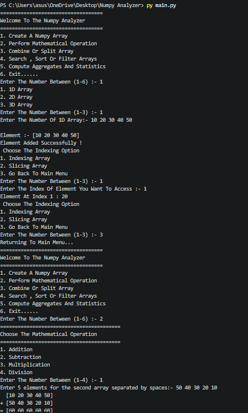

# 1. NumPy Analyzer

## 2. Python NumPy Array Analyzer and Transformer Program

## 3. Features

- Create 1D, 2D, and 3D NumPy Arrays.
- Perform Array Indexing and Slicing.
- Perform Mathematical Operations:
  - Addition
  - Subtraction
  - Multiplication
  - Division
- Combine Arrays.
- Split Arrays.
- Search Array Elements.
- Sort Array Elements.
- Filter Array Values.
- Calculate Sum, Mean, and Median.

## 4. Technologies Used

- Python
- NumPy Library

## 5. Concept Used

- Object-Oriented Programming (OOP)
- Class and Object
- Constructor (`__init__`)
- Methods
- NumPy Array
- Indexing and Slicing
- Conditional Statements
- While Loop
- Exception Handling
- User Input and Output

## 6. How to Used

1. Run the Python program.
2. Select an option from the main menu.
3. Create a 1D, 2D, or 3D NumPy Array.
4. Perform Indexing and Slicing.
5. Perform Mathematical Operations.
6. Combine or Split Arrays.
7. Search, Sort, or Filter Array Elements.
8. Calculate Sum, Mean, and Median.
9. Select Exit to close the program.

## 7. Installation

**Step 1: Install Python**

Download Python from https://www.python.org/

**Step 2: Install NumPy**

Open the terminal and run:

```bash
pip install numpy
```

**Step 3: Run the Program**

```bash
python main.py
```

## 8. Example Output

```text
===================================
Welcome To The Numpy Analyzer
===================================

1. Create A Numpy Array
2. Perform Mathematical Operation
3. Combine Or Split Array
4. Search, Sort Or Filter Arrays
5. Compute Aggregates And Statistics
6. Exit......

Enter The Number Between (1-6) :- 1

1. 1D Array
2. 2D Array
3. 3D Array

Enter The Number Between (1-3) :- 1

Enter The Number Of 1D Array :- 10 20 30 40 50

Element :- [10 20 30 40 50]

Element Added Successfully !
```
## 9. Project Output 



## 10. Project Structure

```text

│
├── main.py
│
└── README.md
│
│__ output.png

```

## 11. Author

*Dev  Thakkar
